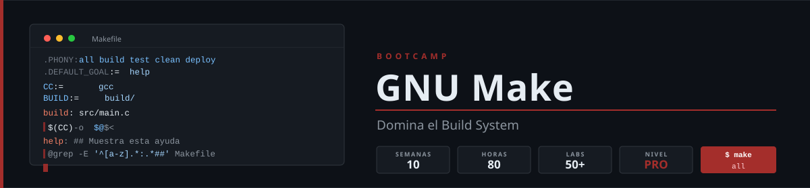

<p align="center">
  
</p>

<p align="center">
  <a href="LICENSE"></a>
  <a href="#"></a>
  <a href="#"></a>
  <a href="#"></a>
</p>

<p align="center">
  <a href="README.md"></a>
</p>

> The course content is written in Spanish. This page summarizes it in English.

---

## 📋 Description

A **Zero to Advanced** bootcamp of **14 weeks (~3.5 months)** focused on mastering **GNU Make** as an automation tool and build system. Self-paced, **10 h/week**, 100% hands-on: it takes developers who never really mastered Make to designing modular, parallel and secure build systems ready for production.

### 🎯 Objectives

By the end of the bootcamp, students will be able to:

- ✅ Write idiomatic Makefiles with correct targets, prerequisites and recipes
- ✅ Master variable flavors (`=`, `:=`, `?=`, `+=`, `!=`) and expansion
- ✅ Write robust recipes in strict mode (`.SHELLFLAGS`, `.DELETE_ON_ERROR`, `.ONESHELL`)
- ✅ Use automatic variables (`$@`, `$<`, `$^`, `$?`, `$*`) fluently
- ✅ Build pattern rules, generate automatic dependencies (`-MMD -MP`) and use special targets
- ✅ Apply text, file and metaprogramming functions (`$(foreach)`, `$(call)`, `$(eval)`, `$(file)`)
- ✅ Debug Makefiles with `--trace`, `--warn-undefined-variables` and `-p`
- ✅ Parallelize builds with `-j`, `--output-sync` and recursion that does not swallow failures
- ✅ Orchestrate Python, Docker and Node.js projects and local CI/CD pipelines with Make
- ✅ Secure a Makefile: secrets, `.env`, command injection, portability and alternatives

### 🔧 Why GNU Make?

> **Modern Make from day 1** — No legacy antipatterns, only current best practices.

GNU Make has been the backbone of the world's most critical build systems for over 40 years. This bootcamp demonstrates that Make is not an old tool: it is the most ubiquitous, portable, and powerful automation tool available on any Unix system. Students learn directly the patterns they will encounter in real Linux, Open Source, and DevOps projects.

---

## 🗓️ Bootcamp Structure

|        Phase           |  Weeks  | Hours | Main Topics                                                          |
| :--------------------: | :-----: | :---: | -------------------------------------------------------------------- |
| **Fundamentals**       |   1-4   |  40h  | Targets, variables, shell and strict mode, automatic variables       |
| **Intermediate**       |   5-8   |  40h  | Pattern rules, automatic dependencies, functions                     |
| **Advanced**           |  9-11   |  30h  | Debugging, parallelism, recursion, modern projects                   |
| **Production**         |  12-14  |  30h  | DevOps, security, portability, capstone project                      |

**Total: 14 weeks** | **140 hours** | Week index with status: [bootcamp/README.md](bootcamp/README.md)

---

## 📚 Weekly Content

```
bootcamp/week-NN-topic_name/
├── README.md                  # Description, objectives and navigation
├── rubrica-evaluacion.md      # Knowledge 30% / Performance 40% / Product 30%
├── checks.json                # Automated checks (autograding)
├── 0-assets/                  # Mermaid diagrams
├── 1-teoria/                  # Minimal context (≤ 45 min)
├── 2-practicas/               # 6 progressive labs (~60 min each)
├── 3-proyecto/                # Weekly integrative project (3 h)
├── 4-recursos/                # Extra resources
└── 5-glosario/                # Key terms of the week
```

### 🗺️ 14-Week Plan

| Week | Topic | Weekly Project |
|------|-------|----------------|
| [01 — Your First Makefile](bootcamp/week-01-tu_primer_makefile/) | Targets, prerequisites, recipes, `.PHONY` | Makefile for a static site |
| [02 — Variables and Expansion](bootcamp/week-02-variables_y_expansion/) | `=` `:=` `?=` `+=` `!=`, CLI override, `$(origin)` | Multi-environment parameterized Makefile |
| [03 — Shell and Strict Mode](bootcamp/week-03-shell_y_modo_estricto/) | `SHELL`, `.SHELLFLAGS`, `.ONESHELL`, `.DELETE_ON_ERROR` | Fail-safe task Makefile |
| [04 — Automatic Variables](bootcamp/week-04-variables_automaticas/) | `$@` `$<` `$^` `$?` `$*` `$(@D)` | Build system for a multi-file C project |
| [05 — Pattern Rules](bootcamp/week-05-reglas_de_patron/) | Pattern rules `%.o: %.c`, static pattern rules | Generic C compiler |
| [06 — Dependencies and Special Targets](bootcamp/week-06-dependencias_y_targets_especiales/) | `-MMD -MP`, order-only, `vpath`, `&:`, `.SECONDARY` | C build with exact header dependencies |
| [07 — Text and File Functions](bootcamp/week-07-funciones_de_texto_y_archivo/) | `$(wildcard)` `$(patsubst)` `$(filter)` `$(dir)` | Automatic rule generator |
| [08 — Advanced Functions](bootcamp/week-08-funciones_avanzadas/) | `$(foreach)` `$(call)` `$(eval)` `$(shell)` `$(file)` | Meta-Makefile: self-generating Makefiles |
| [09 — Conditionals, Include and Debugging](bootcamp/week-09-condicionales_include_y_depuracion/) | `ifeq`, `include`, `--trace`, `--warn-undefined-variables` | Reusable modular Makefile |
| [10 — Parallelism and Recursion](bootcamp/week-10-paralelismo_y_recursion/) | `-j`, jobserver, `-O`, `.WAIT`, `--shuffle`, sub-makes | Monorepo with parallel build and safe recursion |
| [11 — Make for Modern Projects](bootcamp/week-11-makefiles_para_proyectos_modernos/) | Python + uv, Docker, Node.js with Make | Production-ready microservice Makefile |
| [12 — Make as DevOps Orchestrator](bootcamp/week-12-make_como_orquestador_devops/) | Local CI/CD, git hooks, `.env`, secrets | Complete local pipeline |
| [13 — Security, Portability and Alternatives](bootcamp/week-13-seguridad_portabilidad_y_alternativas/) | Threats, testing Makefiles, POSIX/BSD make, just/Task/ninja | Audit and harden a real Makefile |
| [14 — Capstone Project](bootcamp/week-14-proyecto_integrador/) | Everything together | Multi-language build system with Make |

---

## 🛠️ Tools

| Tool | Version | Usage |
|------|---------|-------|
| GNU Make    | **≥ 4.3** (4.4.1 recommended) | Core tool of the bootcamp |
| GCC / Clang | gcc ≥ 11 / clang ≥ 14 | Weeks 4-10 (C projects) |
| Python      | **3.14** + uv | Weeks 11-14 |
| Docker      | Engine 27+ with Compose v2 | Weeks 11-14 |
| Node.js     | **26 LTS** + pnpm (never npm) | Weeks 11-14 |
| jq          | any | Autograding |
| Git         | any | Version control |

Exact versions and rationale: [docs/stack-versions.md](docs/stack-versions.md).

> ⚠️ **macOS** ships GNU Make 3.81 (2006), which is too old for this bootcamp. Install `gmake` with Homebrew: [docs/setup-entorno.md](docs/setup-entorno.md).

---

## 🚀 Quick Start

```bash
git clone https://github.com/ergrato-dev/bc-makefile.git
cd bc-makefile
./scripts/verificar-semana.sh --doctor     # check your environment
cd bootcamp/week-01-tu_primer_makefile     # start here
```

When you finish a week:

```bash
./scripts/verificar-semana.sh 01
```

---

## 📊 Learning Methodology

### Time Distribution (10h/week)

- **Theory**: 45 minutes
- **Knowledge**: 15 minutes (10 rubric questions)
- **Labs**: 6 hours (6 labs × ~60 min)
- **Project**: 3 hours

### Assessment

1. **🧠 Knowledge** (30%): 10 conceptual questions, answered in writing
2. **💪 Performance** (40%): the 6 labs, verified with `make` and autograding
3. **📦 Product** (30%): weekly project — 60 automated points (`checks.json`) + 40 quality points

**Passing criterion**: at least **70% in each evidence**, not on average.

---

## 📞 Support

- 💬 **Discussions**: [GitHub Discussions](https://github.com/ergrato-dev/bc-makefile/discussions)
- 🐛 **Issues**: [GitHub Issues](https://github.com/ergrato-dev/bc-makefile/issues)

---

## ⚠️ Disclaimer

This repository is an **educational** resource created for learning purposes. By using it, you agree to the following terms:

- **Educational purposes only**: The content, code examples, and projects are designed exclusively for teaching and learning. They do not constitute professional, legal, or security advice.
- **No warranties**: The material is provided **"as is"**, without warranties of any kind, express or implied, including fitness for a particular purpose or freedom from errors.
- **Production code**: Code examples are illustrative. Before using them in production environments, you must perform security, performance, and context-specific reviews.
- **Software versions**: Tool versions mentioned may become outdated. Always consult the latest official documentation.
- **Limitation of liability**: The authors and contributors are not responsible for data loss, direct or indirect damages, service interruptions, or any other harm arising from the use of this material.
- **Student responsibility**: Each student is responsible for their own implementations, development environments, and technical decisions.

---

## 📄 License

This project is licensed under **[CC BY-NC-SA 4.0](https://creativecommons.org/licenses/by-nc-sa/4.0/)** (Creative Commons Attribution-NonCommercial-ShareAlike 4.0 International).

**You may:** share and adapt the material, including creating educational forks.<br>
**You may not:** use this material for commercial purposes.<br>
**You must:** give appropriate credit and distribute adaptations under the same license.

See the [LICENSE](LICENSE) file for the full text.

---

## 🏆 Acknowledgments

- [GNU Make](https://www.gnu.org/software/make/) — For four decades as the world's most reliable build system
- [GNU Make Manual](https://www.gnu.org/software/make/manual/) — The most comprehensive official documentation
- Open Source Community — For real projects where Make remains the standard
- All contributors

---

## 📚 Additional Documentation

- [📜 Code of Conduct](CODE_OF_CONDUCT.md)
- [🔒 Security Policy](SECURITY.md)
- [🛠️ Environment setup (ES)](docs/setup-entorno.md)
- [🤖 Autograding (ES)](docs/autograding.md)

---

<p align="center">
  <strong>🎓 GNU Make Bootcamp — Zero to Advanced</strong><br>
  <em>From zero to advanced automation in 14 weeks</em>
</p>

<p align="center">
  <a href="bootcamp/week-01-tu_primer_makefile">Start Week 1</a> •
  <a href="https://github.com/ergrato-dev/bc-makefile/issues">Report Issue</a>
</p>

<p align="center">
  Made with ❤️ for the developer community
</p>
