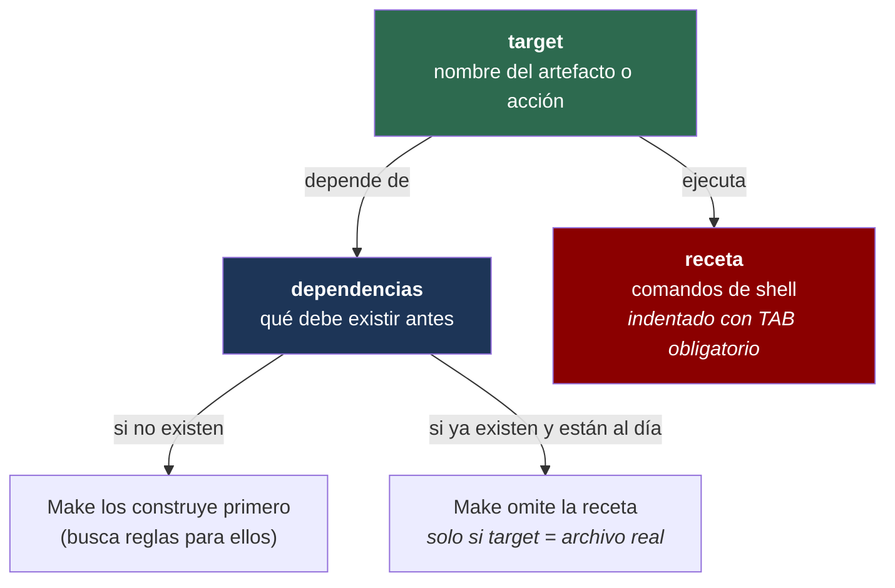

# Anatomía de una regla Make



```makefile
# Ejemplo de la anatomía completa:
#
#   target  :  dependencia1  dependencia2
#   [TAB]      receta_línea_1
#   [TAB]      receta_línea_2
#
build: src/main.c src/utils.c
	gcc -o programa src/main.c src/utils.c
	echo "Build completo"
```

El **TAB** es el único separador válido entre el margen izquierdo y la receta. Espacios producen `missing separator. Stop.`
