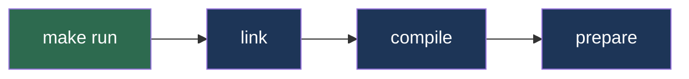

# Cadena de dependencias



Make recorre el árbol de dependencias de **derecha a izquierda** (de las hojas hacia la raíz) y ejecuta en orden inverso: primero `prepare`, luego `compile`, `link`, y finalmente `run`.

```makefile
run: link
	@echo "Ejecutando..."

link: compile
	@echo "Vinculando..."

compile: prepare
	@echo "Compilando..."

prepare:
	@echo "Preparando..."
```

Ejecutar `make compile` solo activa `prepare → compile`. Make no ejecuta más de lo necesario.
