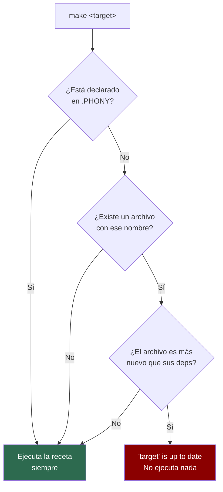

# PHONY vs Target de archivo



**Regla práctica:** si un target no produce un archivo con su mismo nombre, decláralo `.PHONY`. Siempre.

```makefile
.PHONY: build clean test help   ← estos no producen archivos llamados
                                  'build', 'clean', 'test' ni 'help'

reporte.txt: datos.csv          ← este SÍ produce 'reporte.txt';
	cat datos.csv > reporte.txt   no va en .PHONY
```
