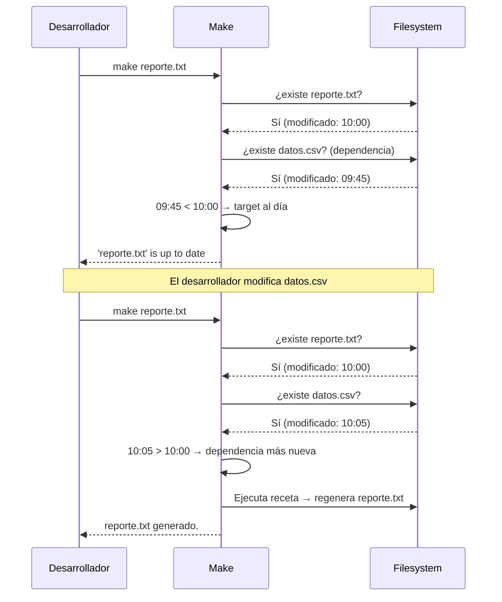

# Lógica de timestamps en Make



Make **no rastrea contenido**, solo timestamps (`mtime`). Si necesitas forzar re-ejecución aunque nada cambió:

```bash
make -B reporte.txt   # --always-make: ignora timestamps
touch datos.csv       # actualiza mtime de la dependencia
```
