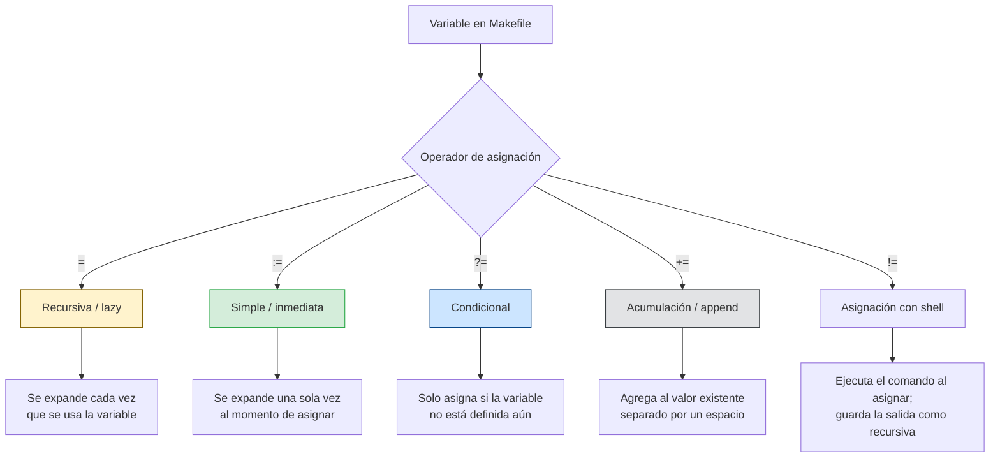

# Tipos de variable en Make: los operadores de asignación

El operador `:=` es el más predecible y el recomendado como default: evalúa una vez y el resultado no cambia. El operador `=` es poderoso pero riesgoso: puede causar recursión infinita si una variable se referencia a sí misma. Usa `?=` para defaults que el usuario pueda sobreescribir desde CLI sin editar el archivo. `$(flavor VAR)` confirma el tipo resultante: `simple` solo para `:=`; `recursive` para el resto.
