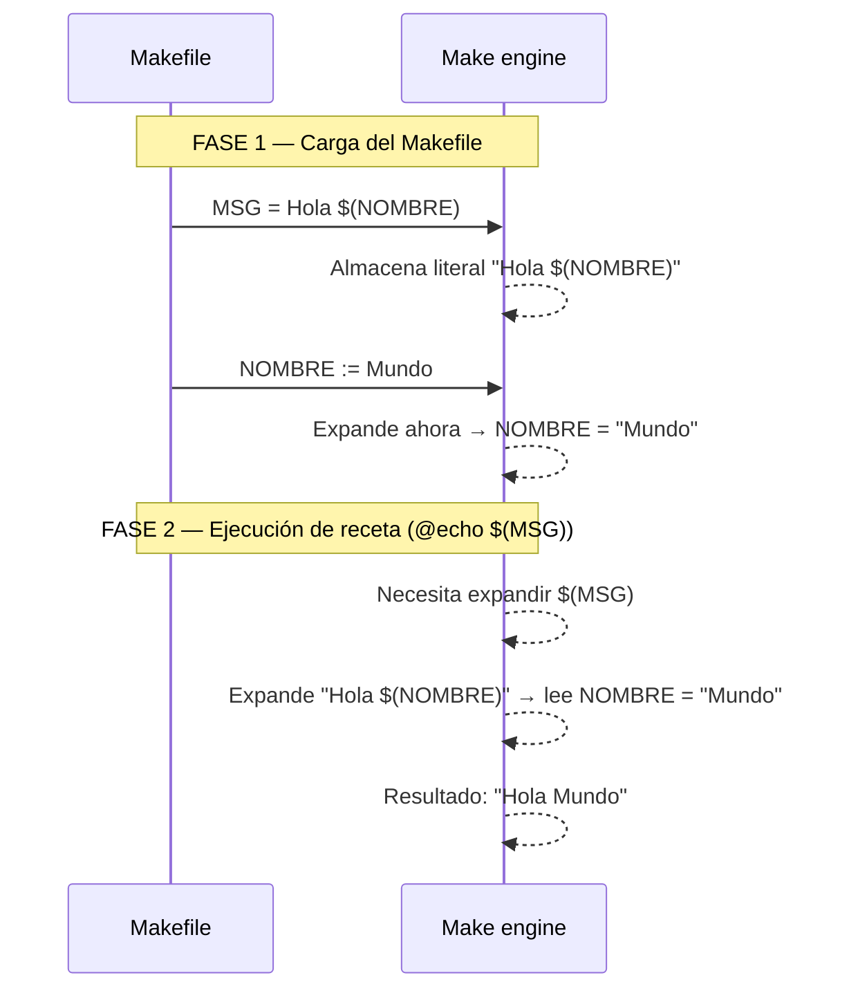

# Expansión recursiva (=) vs. inmediata (:=)

Con `=`, Make almacena la expresión sin evaluarla y la expande en el momento de uso. Esto permite que `MSG` referencie `NOMBRE` aunque `NOMBRE` se defina después en el archivo. Con `:=`, `MSG` capturaría el valor de `NOMBRE` al momento de definir `MSG` — si `NOMBRE` no está definido aún, `MSG` quedaría vacío.
