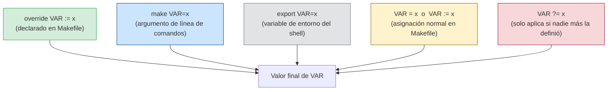

# Precedencia de variables: quién gana cuando hay conflicto

**Flujo práctico:**

- `?=` → valor por defecto que cualquiera puede sobreescribir
- `= / :=` → valor interno del Makefile (pierde ante CLI y entorno)
- CLI `make VAR=x` → sobreescribe todo excepto `override`
- `override` → el Makefile impone su valor sin importar qué pase desde afuera (raro, úsalo con cuidado)

El patrón más común es: `?=` para defaults + CLI para configurar = Makefile flexible sin editar.
