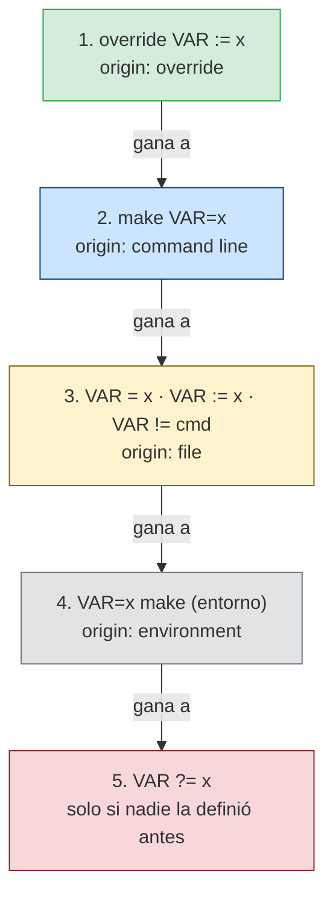

# Precedencia de variables: quién gana cuando hay conflicto

Una asignación normal del Makefile (3) gana a la variable de entorno (4): por eso los valores configurables se definen con `?=`, que solo actúa si ni la CLI ni el entorno trajeron valor. `$(origin VAR)` te dice en qué caja cayó el valor que estás viendo, y `make -e` intercambia las cajas 3 y 4 (no lo uses como arreglo).
