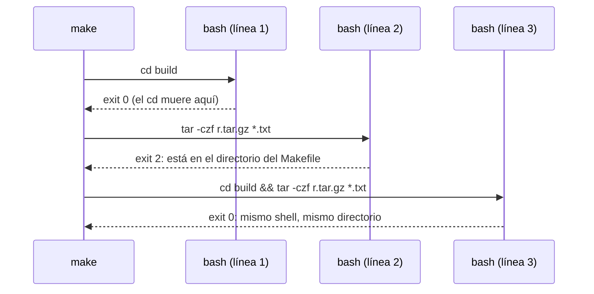

# Cada línea de receta, un shell nuevo

Make expande `$(...)` y `$$` y lanza un proceso de shell por cada línea de receta. Directorio actual, variables de shell y `export` no sobreviven al final de la línea. Para compartir estado, encadena con `&&` o une líneas con `\`; `.ONESHELL` lo hace para todo el Makefile, con sus trampas.
