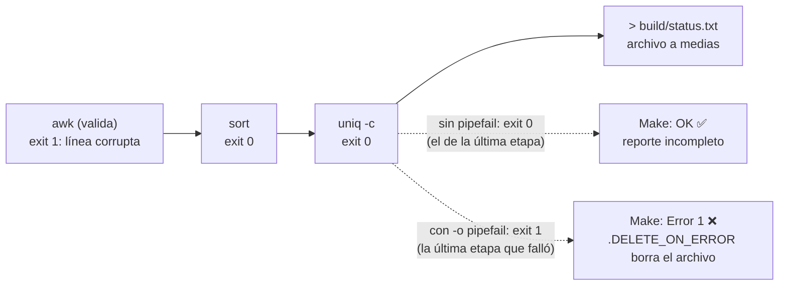

# Código de salida de una tubería, con y sin pipefail

Sin `pipefail`, el código de una tubería es el de su última etapa: el fallo de `awk` desaparece detrás de `sort` y `uniq`. Con `-o pipefail`, cualquier etapa que falle hace fallar la línea. Dos excepciones que hay que tratar a propósito: `grep` sin coincidencias (exit 1) y el productor que muere con SIGPIPE (141) cuando `head` cierra la tubería.
