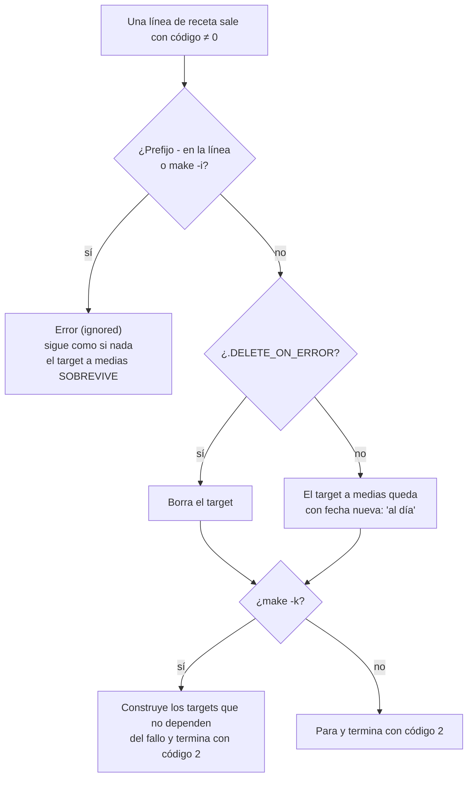

# Qué hace Make cuando una receta falla

`.DELETE_ON_ERROR` evita que un archivo a medio escribir pase por bueno en la siguiente ejecución. El prefijo `-` y `make -i` anulan el error, y con él la limpieza: úsalos solo donde el fallo no cambia el resultado. `make -k` es seguro: sigue con lo independiente, pero el código de salida sigue siendo de error.
