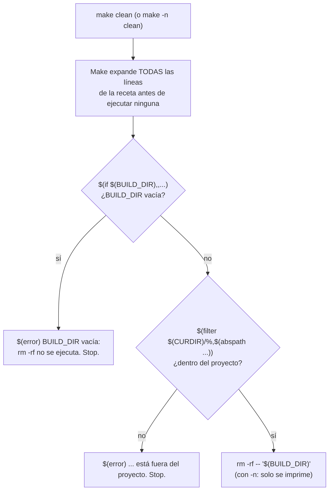

# Guardas de un clean seguro

Las guardas son funciones de Make, no comandos de shell: se evalúan al expandir la receta, así que paran el `clean` también en una previsualización con `make -n`. Las comillas simples y el `--` protegen de rutas con espacios o que empiezan por `-`.
