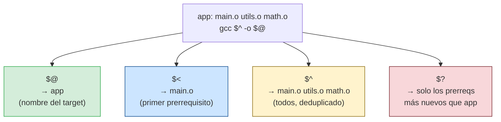

# Variables automáticas: de dónde viene cada una

Make inyecta estas variables en la receta en el momento de ejecución. `$@` y `$<` son las más usadas en compilación: `$<` es el único archivo fuente para `gcc -c`, y `$@` es el archivo objeto de salida. `$^` va al linker porque necesita todos los `.o`. `$?` solo tiene sentido en targets reales (no `.PHONY`): lista los prerrequisitos modificados desde el último build.
