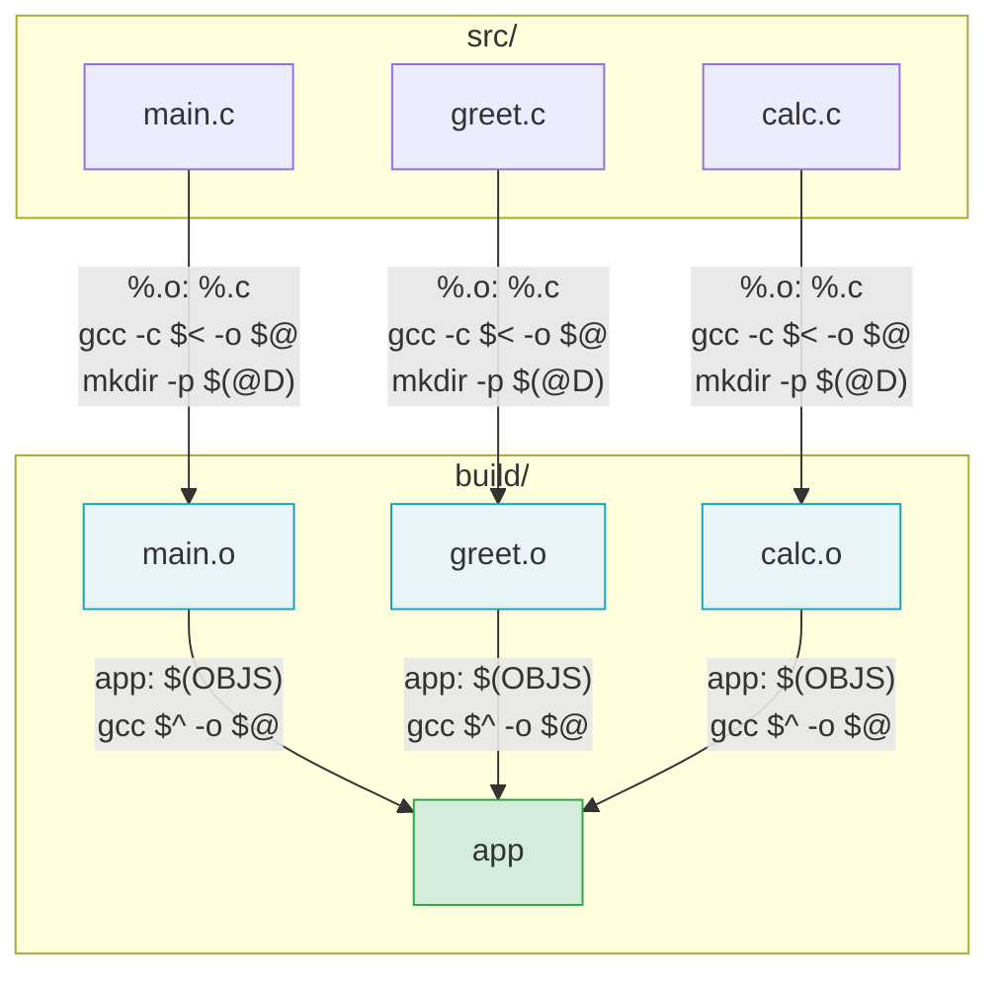

# Flujo de compilación C con variables automáticas

Una sola regla de patrón `$(BUILD)/%.o: $(SRC)/%.c` compila los tres archivos. Make aplica la misma regla tres veces, sustituyendo el stem (`main`, `greet`, `calc`) en cada invocación. `$(@D)` = `build` en los tres casos; `mkdir -p $(@D)` crea el directorio una sola vez y no falla si ya existe.
