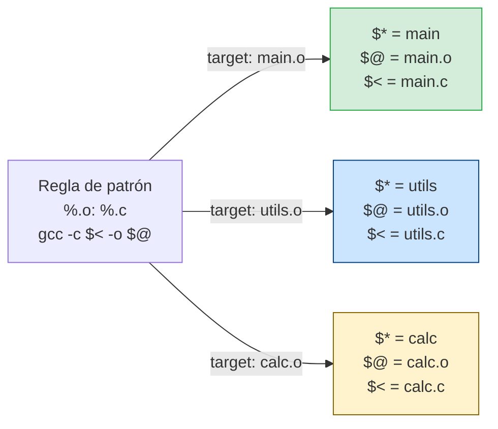

# El stem `$*` en reglas de patrón

El `%` en una regla de patrón actúa como wildcard. El texto que coincide con `%` se llama **stem** y se expone en `$*`. En el ejemplo, el stem es el nombre del módulo sin extensión. `$*` es útil cuando necesitas derivar otras rutas a partir del stem: `$(BUILD)/$*.d` para archivos de dependencias, o `$(DOCS)/$*.html` para documentación generada. Fuera de una regla de patrón, `$*` siempre expande a cadena vacía.
