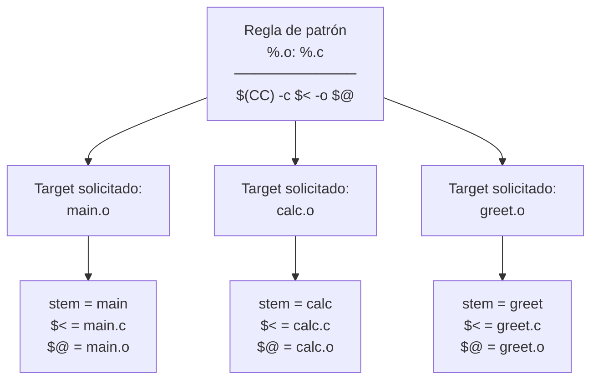

# Anatomía de una regla de patrón

Una sola regla de patrón se instancia una vez por target. El `%` captura el stem (la parte variable) y lo propaga a prerrequisitos y variables automáticas. Sin reglas de patrón, cada `%.o` requeriría su propia regla explícita.
