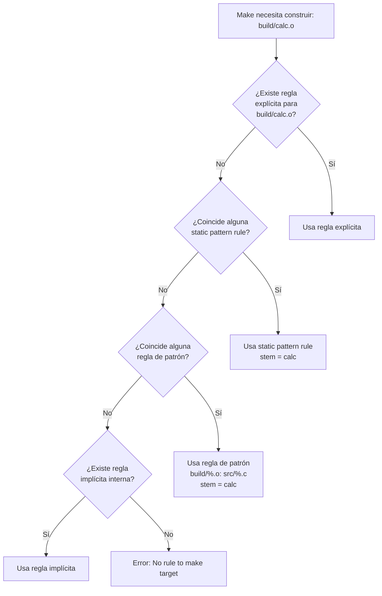

# Flujo de resolución de stem en Make

Make busca reglas de mayor a menor especificidad. La regla explícita siempre gana. Las reglas implícitas internas (como `%.o: %.c` que Make conoce de fábrica) son la última opción antes del error. Definir tus propias reglas de patrón anula las implícitas.
