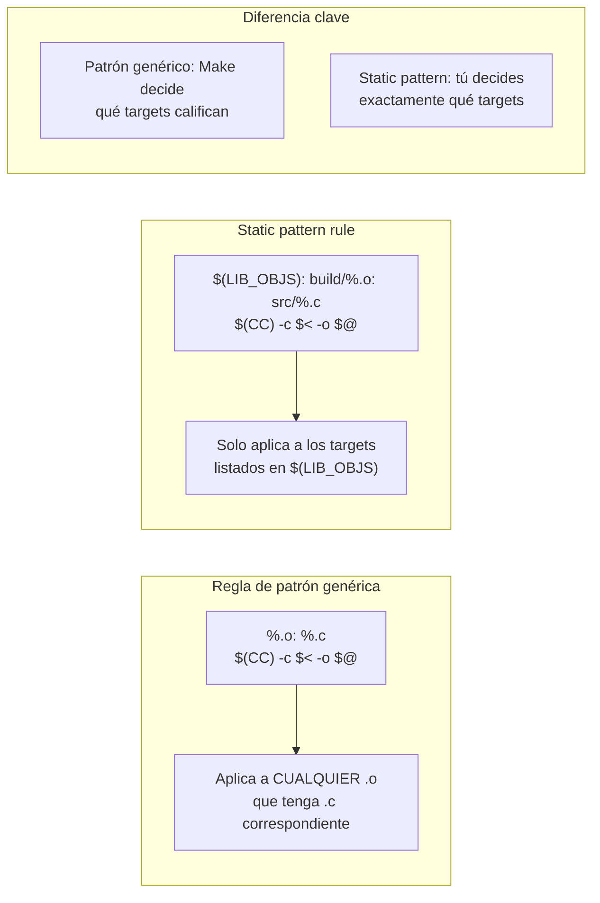

# Regla de patrón vs static pattern rule

La static pattern rule `$(TARGETS): patrón-target: patrón-prerreq` tiene tres partes: lista de targets, patrón del target, patrón del prerrequisito. Es más predecible que el patrón genérico porque no aplica a targets inesperados que accidentalmente coincidan con el patrón.
