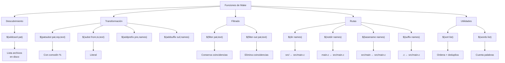

# Mapa de Funciones de Texto y Archivo

Las funciones se agrupan en cuatro categorías según su propósito: descubrimiento (en disco), transformación (cambio de forma), filtrado (selección de subconjuntos) y manipulación de rutas (extracción de partes del path). En la práctica siempre se combinan: `wildcard` descubre, `patsubst` transforma, `filter` refina.
