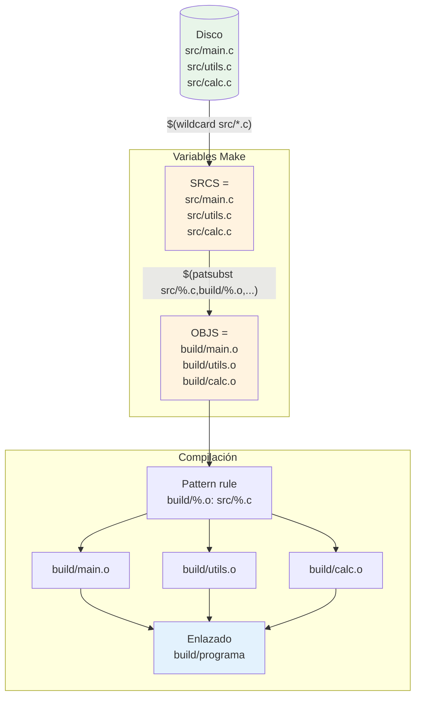

# Flujo: wildcard → patsubst → compilación

El flujo tiene tres fases: `$(wildcard)` consulta el disco y genera una lista de rutas reales; `$(patsubst)` transforma esa lista de `.c` a `.o` sin tocar el disco; el pattern rule usa la lista de objetos para disparar la compilación de cada par `src/*.c → build/*.o`. Agregar un nuevo `.c` en `src/` hace que la cadena completa se actualice sola en la siguiente ejecución de `make`.
