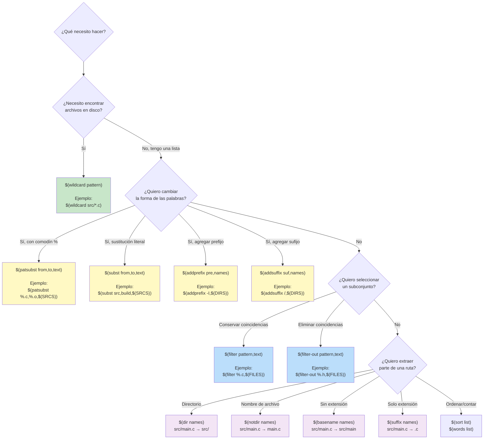

# Árbol de decisión: ¿qué función usar?

La pregunta clave es el punto de partida: **¿necesito archivos del disco o ya tengo una lista?** `$(wildcard)` es la única función que consulta el sistema de archivos — todas las demás operan sobre strings. Combina `wildcard` primero, luego `patsubst` para transformar, y `filter` para refinar.
