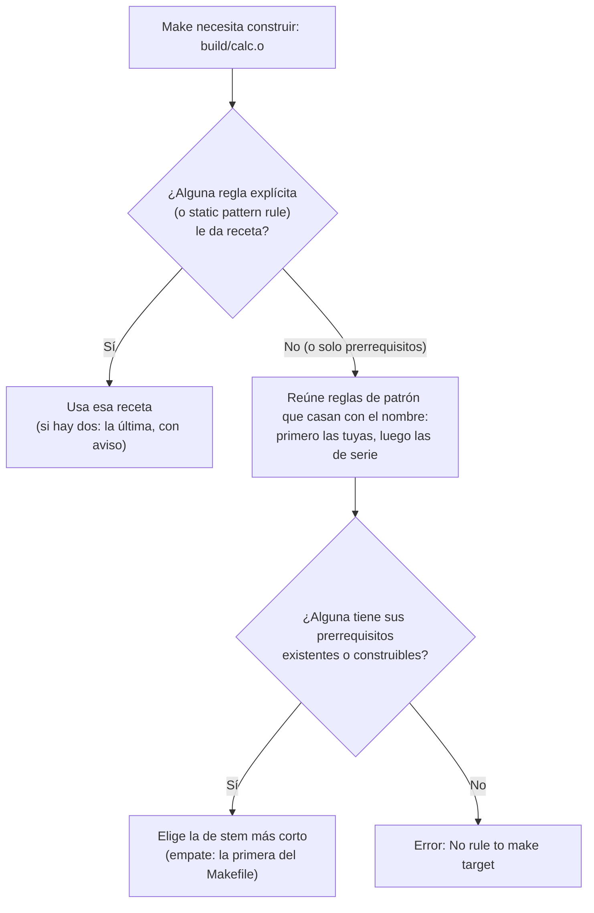

# Cómo elige Make la regla de un target

Una regla explícita sin receta (`main.o: config.h`) no detiene la búsqueda: solo añade prerrequisitos a la regla de patrón que se elija. Las reglas de serie (`%.o: %.c`, `%: %.c`, `%: %.sh`…) entran en la misma búsqueda, por detrás de las tuyas; con `MAKEFLAGS += -r` desaparecen.
