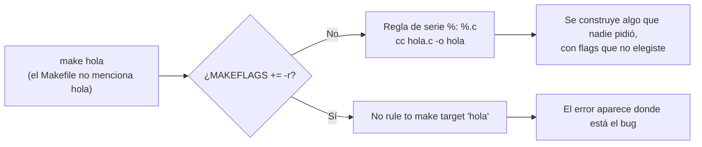

# Reglas de serie: con y sin `-r`

GNU Make trae unas noventa reglas de patrón de fábrica (`make -p -f /dev/null` las lista). `-r` las elimina junto con los sufijos antiguos (`.c.o:`); `-R` además elimina variables como `CC` y `CFLAGS`. Tus propias reglas de patrón siguen funcionando.
