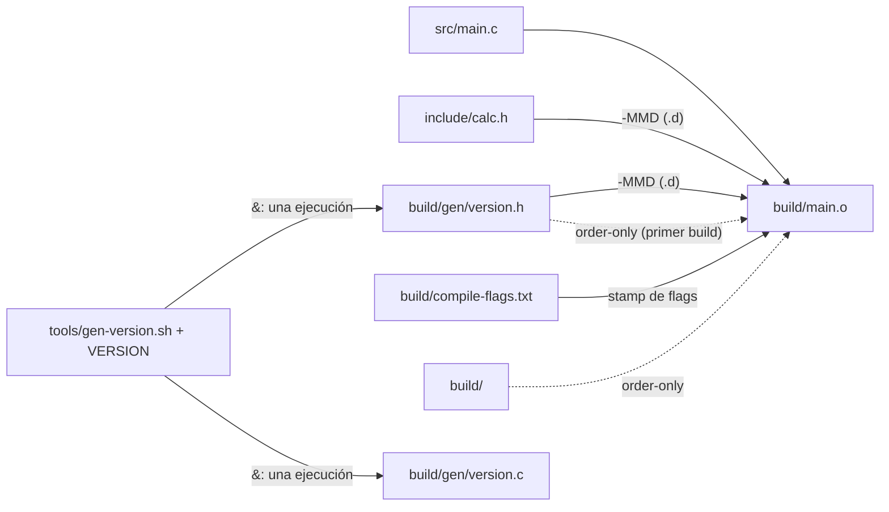

# El grafo completo de un objeto

Las flechas continuas son prerrequisitos normales: si su fecha es más nueva, `main.o` se recompila. Las discontinuas son order-only: solo tienen que existir. El header generado aparece dos veces a propósito: order-only para que exista en el primer build, y normal a través del `.d` a partir del segundo.
