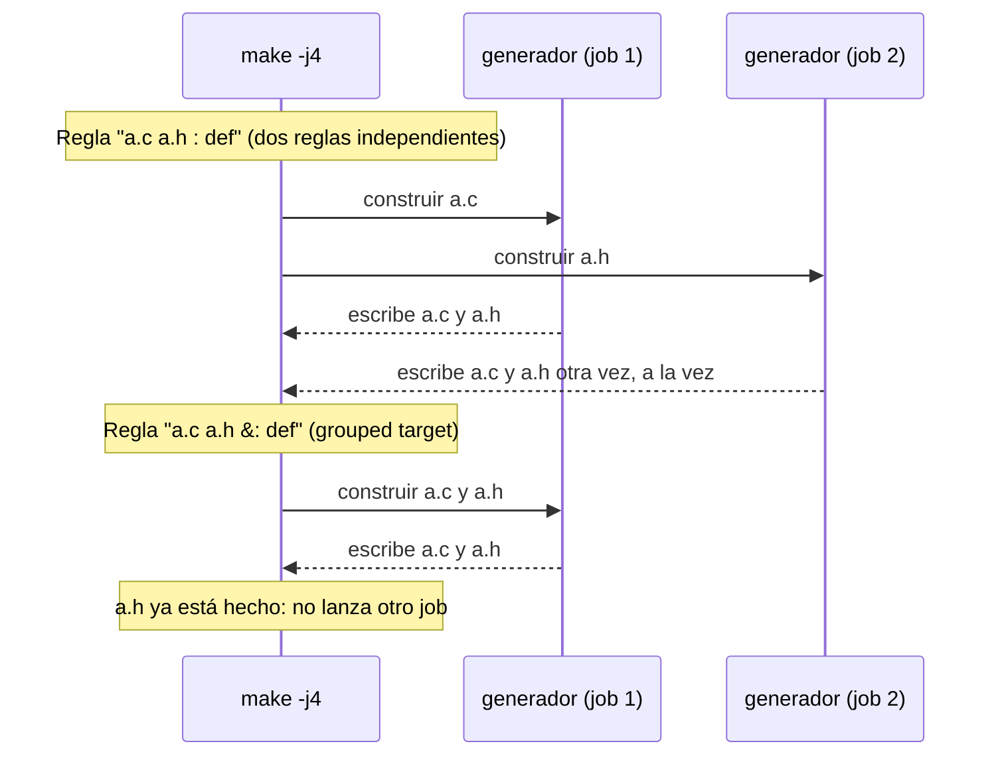

# Un generador, dos targets y `make -j`

Con `:` cada target tiene "su" copia de la receta y en paralelo Make lanza las dos. Con `&:` Make sabe que una ejecución actualiza todo el grupo. En serie el bug casi nunca se ve, por eso llega a producción.
