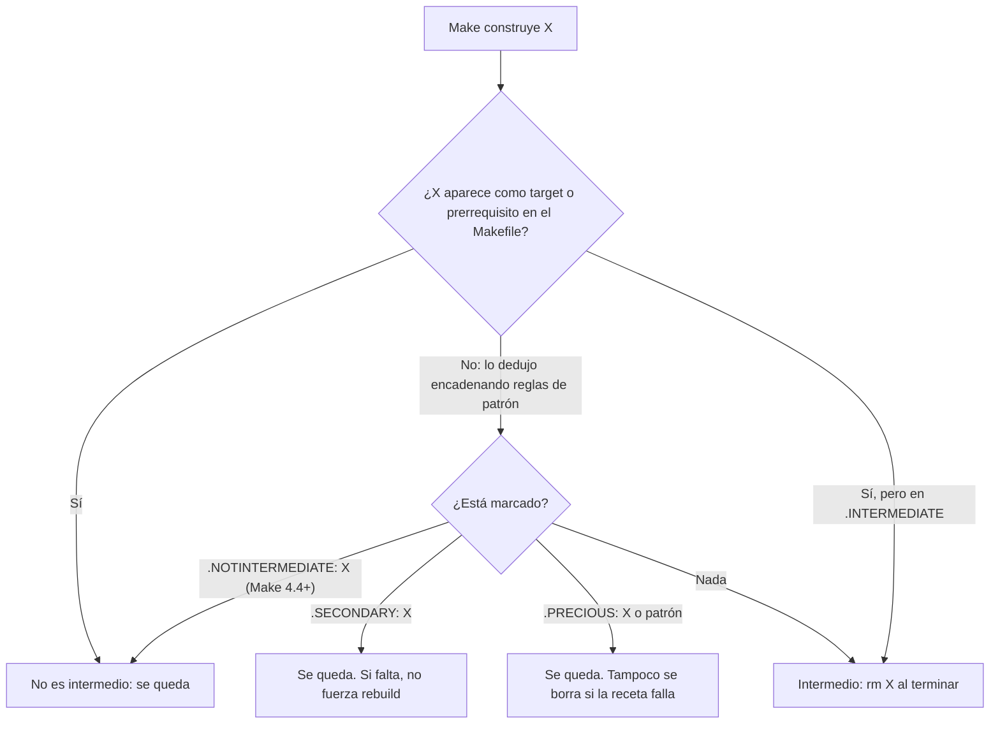

# ¿Make va a borrar este archivo?

Un archivo es intermedio cuando Make lo necesitó para una cadena de reglas de patrón pero nadie lo nombró. Elige la marca por el efecto que quieres: `.SECONDARY` conserva, `.PRECIOUS` conserva incluso tras un fallo (y anula `.DELETE_ON_ERROR`), `.NOTINTERMEDIATE` lo saca de la categoría.
