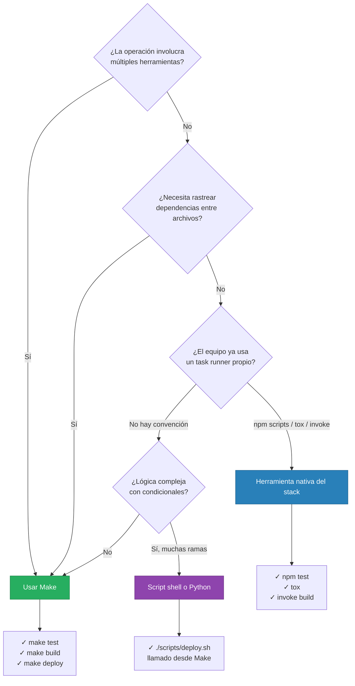

# ¿Cuándo usar Make vs scripts vs herramientas nativas?

La regla práctica: usa Make como orquestador principal y llama herramientas nativas desde sus recetas. Un Makefile puede llamar `npm test` o `pytest` directamente — no tiene que reemplazarlos, solo tiene que envolverlos en una interfaz consistente. Los scripts shell complejos deben vivir en `scripts/` y ser llamados desde Make, no embebidos en recetas largas.
