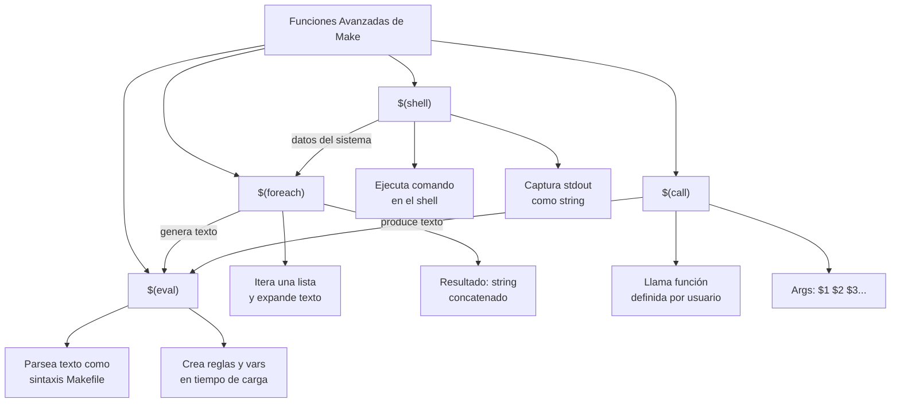

# Mapa de Funciones Avanzadas de Make

`$(foreach)` genera texto iterando una lista. `$(call)` invoca plantillas con argumentos nombrados. `$(eval)` convierte ese texto en reglas Make reales. `$(shell)` trae datos del sistema operativo al Makefile. Las cuatro juntas permiten construir Makefiles que se configuran solos.
