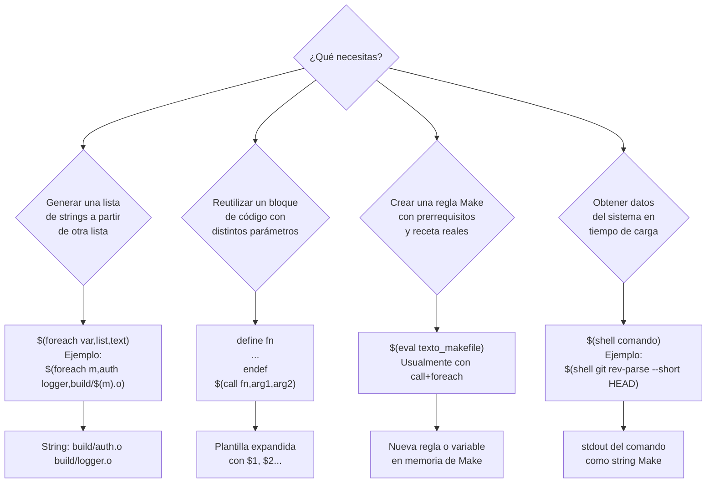

# ¿Cuándo usar cada función avanzada?

Regla práctica: `$(foreach)` para generar listas de texto, `$(call)` para reutilizar plantillas, `$(eval)` cuando el resultado de la plantilla debe ser una *regla con prerrequisitos y receta*, y `$(shell)` para incorporar datos del entorno (git, fecha, OS) que no puedes conocer al escribir el Makefile.
