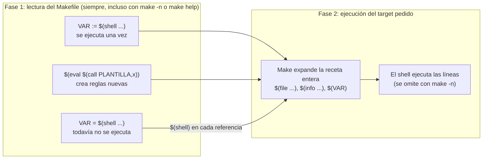

# Cuándo se expande cada función

`:=` y `$(eval)` actúan en la lectura, pidas el target que pidas: un `$(shell)` lento o con una variable de fuera cuesta y se ejecuta incluso en `make -n help`. `$(file)` e `$(info)` actúan al expandir la receta, antes de su primera línea y también con `-n`; solo el shell de la receta queda protegido por `-n`.
