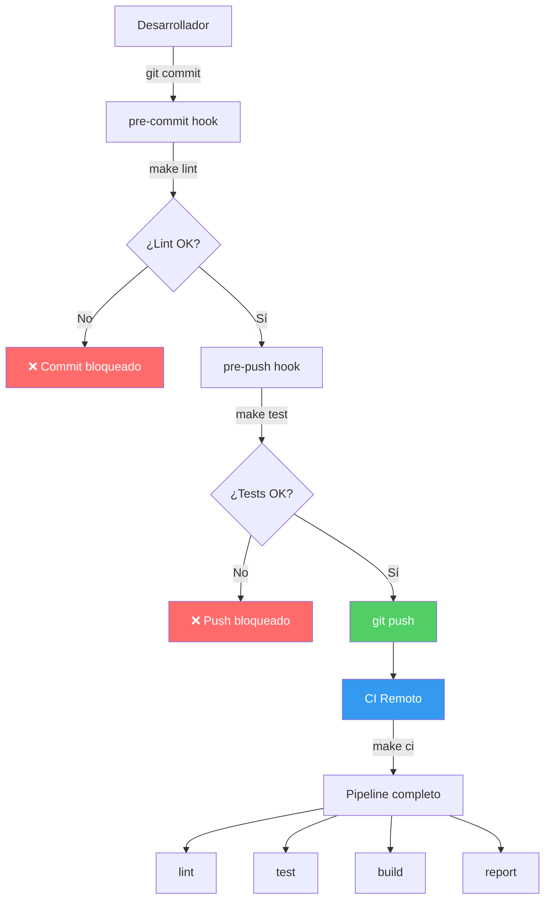

# Make como Orquestador DevOps

Make actúa como dispatcher: el desarrollador ejecuta un solo comando y Make orquesta lint, tests, build y reporte en el orden correcto. Los git hooks extienden este modelo al nivel del repositorio, bloqueando código que no pasa el pipeline antes de que llegue al servidor remoto.
