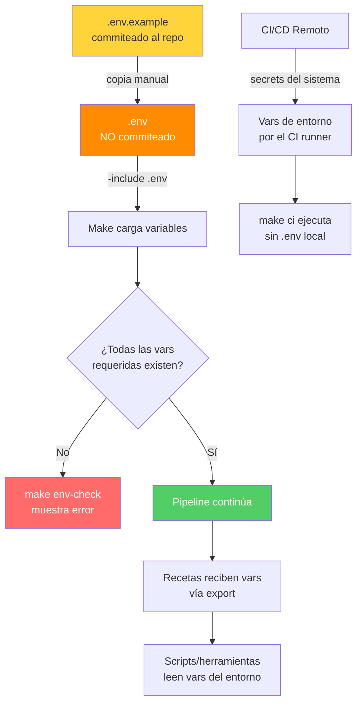

# Flujo de Variables de Entorno y Secretos

El patrón fundamental: `.env.example` va al repositorio como plantilla, `.env` contiene los valores reales y se ignora en `.gitignore`. Make carga el `.env` local con `-include` (no falla si no existe) y expone las variables al shell con `export`. En CI, las variables llegan directamente del runner sin necesitar `.env`.
