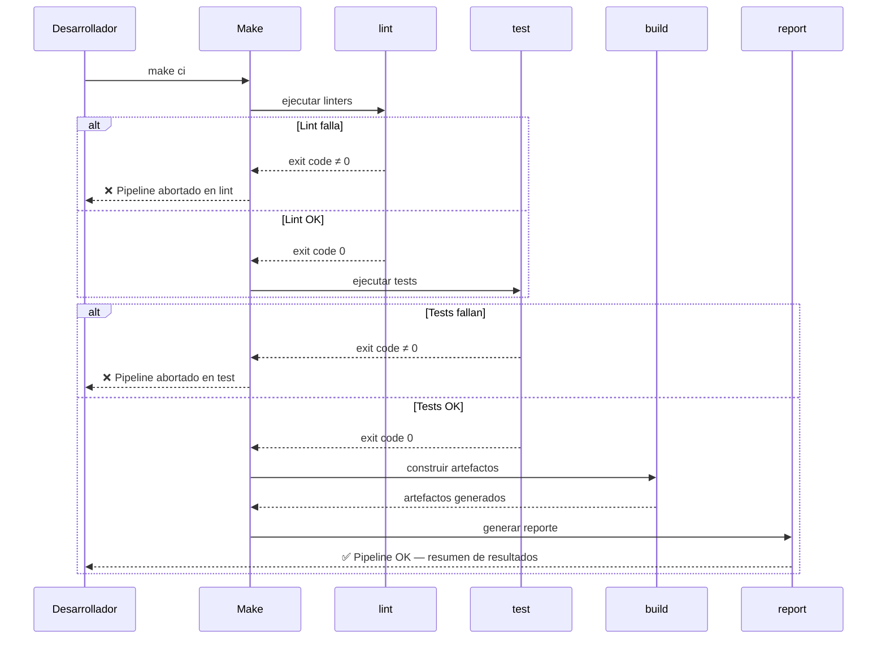

# Etapas del Pipeline CI/CD Local

Make ejecuta las etapas como dependencias en cadena. Si cualquier etapa retorna un código de salida distinto de cero, Make aborta inmediatamente — el mismo comportamiento que un pipeline CI remoto. El target `ci` agrega un target padre que encadena: `ci: lint test build report`.
