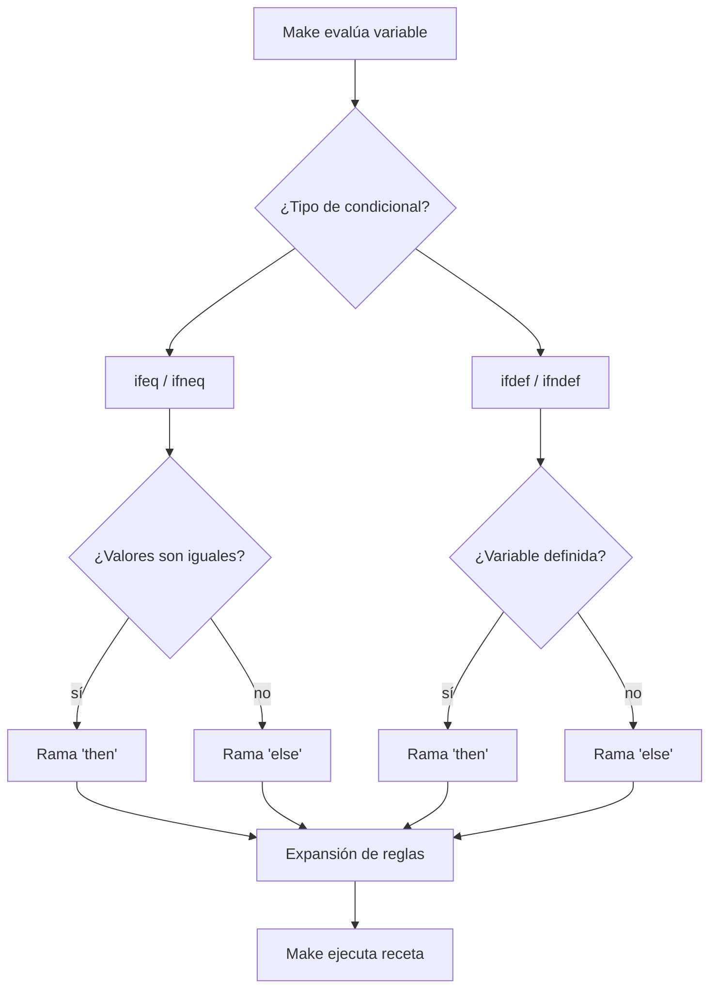

# Condicionales en Make

Los condicionales en Make se evalúan **en tiempo de lectura** (parsing), no en tiempo de ejecución. Esto significa que `ifeq` no puede depender de la salida de un comando en la receta — para eso se usa `$(shell ...)` antes del condicional. La elección entre `ifeq`/`ifneq` (compara valores) y `ifdef`/`ifndef` (compara existencia) determina qué tipo de condición puedes expresar.
