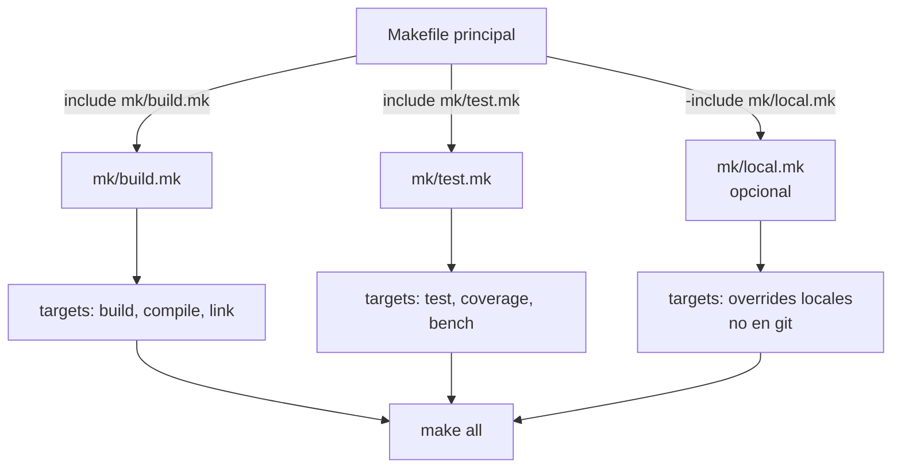

# Include y Makefiles Modulares

`include` detiene Make con error si el archivo no existe y no hay regla para generarlo. `-include` (con guion) lo ignora en silencio: es para archivos opcionales como un `local.mk` con overrides personales. Ojo con `.env`: se parsearía como Makefile, no como shell. Un módulo `.mk` es un Makefile parcial: define variables y targets pero no tiene `.DEFAULT_GOAL`. El Makefile principal orquesta qué módulos carga y en qué orden, controlando qué target es el predeterminado.
