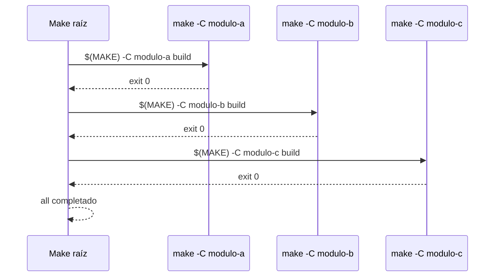

# Recursión y Submakes

`$(MAKE) -C directorio target` cambia al directorio y ejecuta el `Makefile` de allí. Usar `$(MAKE)` (no `make` literal) garantiza que se usa el mismo binario y flags que el proceso padre. Las variables definidas en el Makefile del padre **no** se heredan solas: llegan las de la línea de comandos (vía `MAKEFLAGS`), las del entorno, las exportadas por nombre (`export VAR`) y las pasadas como argumento (`ENV=$(ENV)`). Esto es intencional: cada submake debe ser autónomo y ejecutable de forma independiente.
