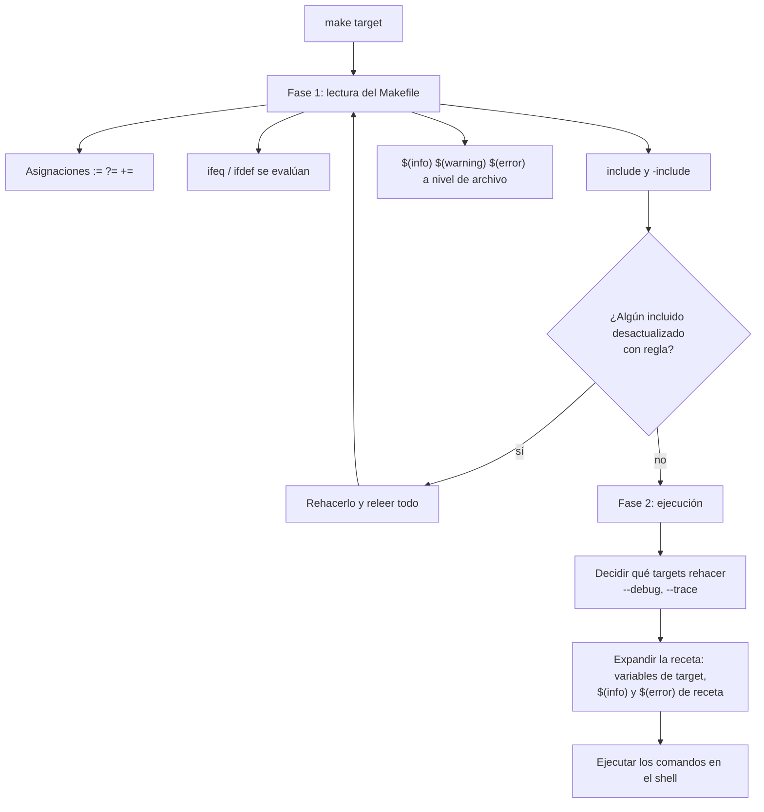

# Fases de Make: lectura y ejecución

Casi todos los fallos de esta semana son de fase: un `ifeq` que no ve una
variable de target (se evaluó en la fase 1), un `$(error)` de archivo que rompe
`make help`, o un `$(info)` que se imprime con `make -n` porque expandir la
receta es parte de la fase 2 aunque no se ejecute nada.
