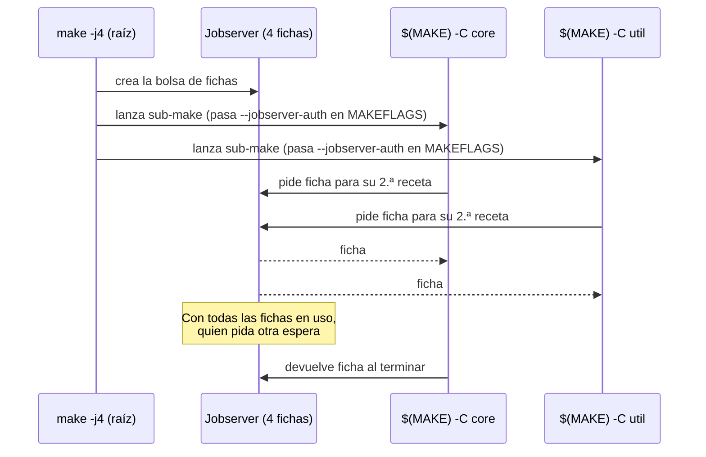

# El jobserver: un `-j` para todo el árbol de sub-makes

Con `make -j4`, el padre reparte 4 fichas entre todos los sub-makes: nunca hay más de 4 recetas en marcha en todo el árbol. Solo las líneas con `$(MAKE)` (o con prefijo `+`) reciben acceso a la bolsa. Un `make` literal en Make 4.3, o un `-j4` escrito dentro de la receta, rompe el reparto: el hijo cae a `-j1` o crea su propia bolsa.
