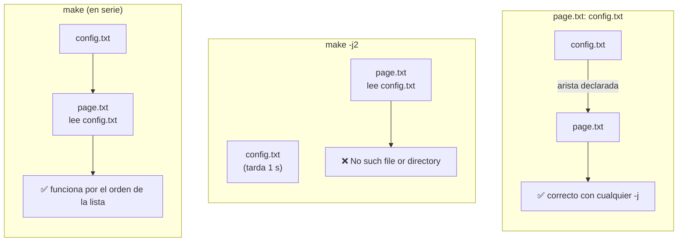

# Una carrera es una dependencia que falta

En serie, Make sigue el orden en que escribiste los prerrequisitos, y eso tapa la dependencia que falta. Con `-j` solo respeta las aristas del grafo, así que `page.txt` arranca a la vez que `config.txt`. El arreglo nunca es quitar `-j` ni añadir `.NOTPARALLEL`: es declarar la arista que faltaba.
