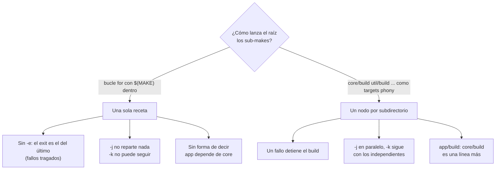

# Bucle `for` frente a subdirectorios como targets

El bucle `for` esconde los subdirectorios dentro de una receta, fuera del alcance de Make. Convertir cada pareja directorio/meta en un target phony (`$(MAKE) -C $(@D) $(@F)`) los devuelve al grafo, y con ellos vuelven `-j`, `-k`, la propagación de fallos y las dependencias entre paquetes.
