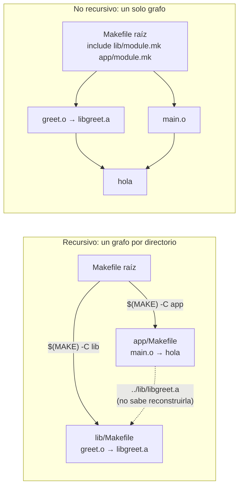

# Make recursivo frente a no recursivo

En el modelo recursivo, cada sub-make solo conoce su directorio: la flecha punteada es una dependencia que `app/Makefile` no puede satisfacer por sí mismo. En el no recursivo, los `module.mk` se incluyen en un único Make, así que todas las aristas (también las de headers entre directorios) están en el mismo grafo y `-j`, `-n` e incrementales funcionan sin sub-makes.
