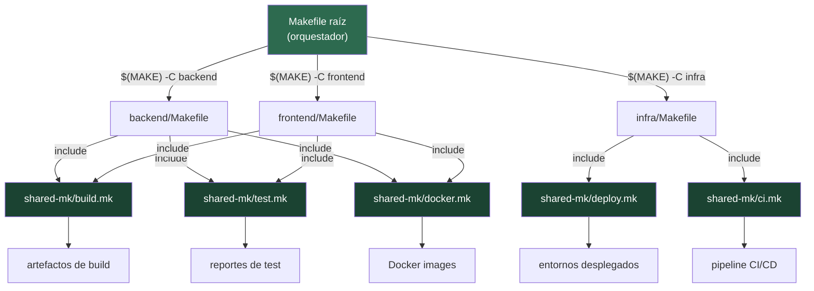

# Arquitectura de un Build System Multi-Lenguaje con Make

El Makefile raíz no sabe cómo compilar Python ni Node.js — solo orquesta. Cada servicio importa los módulos `.mk` compartidos y define sus variables locales. La librería `shared-mk/` es el único lugar donde se actualiza la lógica de build, test y deploy.
