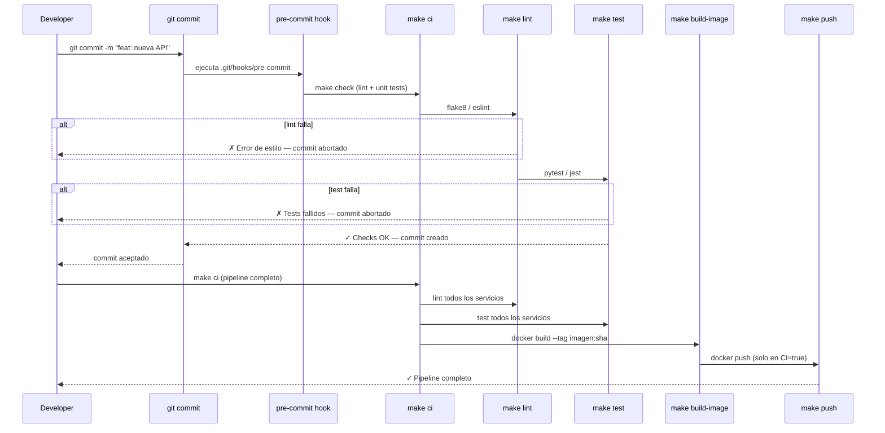

# Flujo del Pipeline CI Completo

El pipeline local replica lo que ejecutaría CI en la nube. Si `make ci` pasa localmente, tiene alta probabilidad de pasar en GitHub Actions o GitLab CI. Los git hooks garantizan que los checks básicos corren antes de cada commit, sin depender de la plataforma CI.
