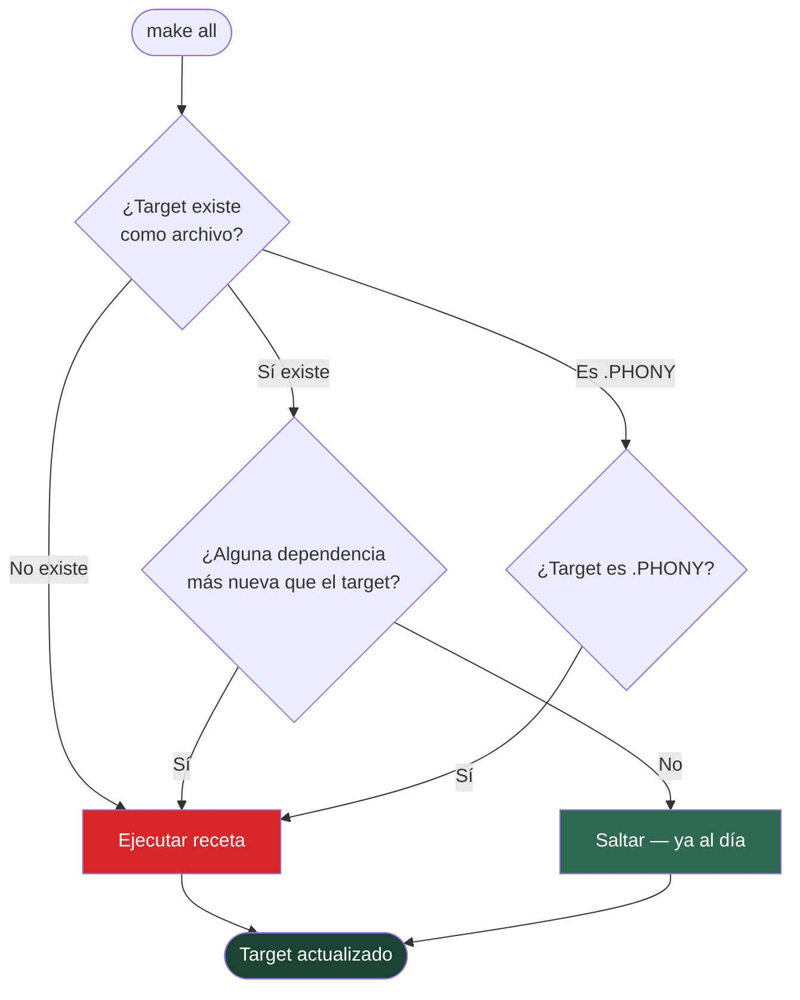

# Decisión de Make: ¿Qué reconstruir?

Make compara timestamps: si el target es más nuevo que todas sus dependencias, no hay trabajo que hacer. Los targets `.PHONY` (como `clean`, `test`, `deploy`) nunca se consideran al día — siempre se ejecutan. Los archivos `.stamp` (archivos vacíos usados como marcadores de tiempo) permiten aplicar esta lógica a tareas que no producen un artefacto natural, como `pip install` o `npm install`.
