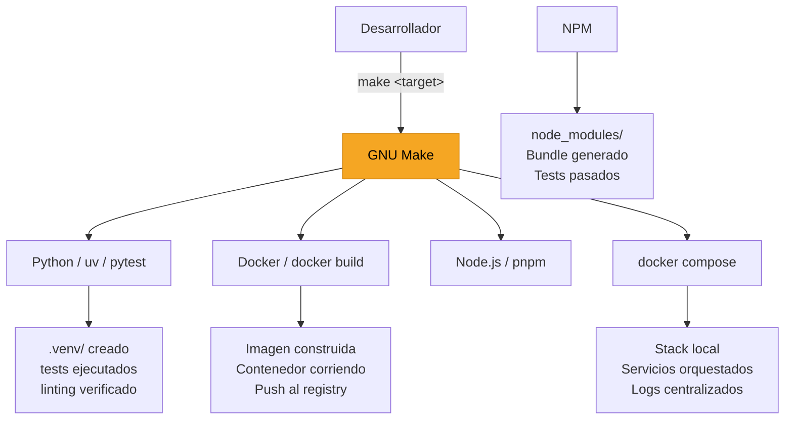

# Make como interfaz universal

Make actúa como una capa de abstracción: el desarrollador ejecuta siempre el mismo comando (`make test`, `make build`, `make deploy`) sin necesidad de recordar los flags y subcomandos específicos de cada herramienta. Esta consistencia es especialmente valiosa en equipos y en entornos CI donde cualquier colaborador debe poder ejecutar las mismas operaciones sin documentación adicional.
