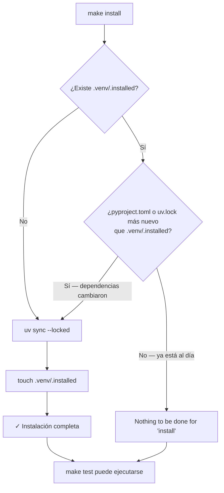

# Flujo del Sentinel File (Archivo Testigo)

El sentinel file (`.venv/.installed`) es un archivo vacío cuya única función es registrar cuándo se ejecutó `uv sync` por última vez. Make compara su fecha de modificación con la de `pyproject.toml` y `uv.lock`: si alguno es más reciente, la instalación se repite; si no, Make la omite. Este patrón evita reinstalar dependencias en cada `make test`, lo que puede ahorrar minutos por ejecución en proyectos con muchas dependencias.
