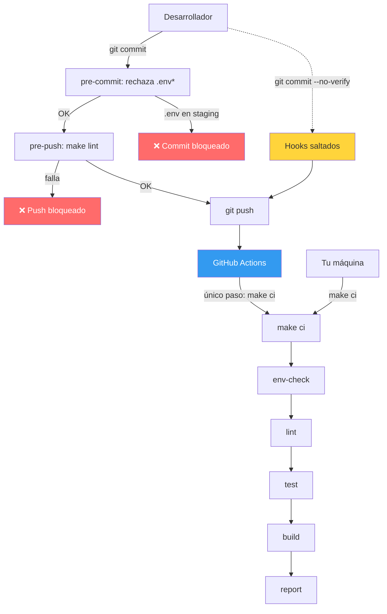

# Make como orquestador DevOps

Los hooks detectan errores pronto en la máquina del desarrollador, pero `--no-verify` los salta: son una ayuda. El control que no se puede saltar es el workflow de CI, y ese workflow solo ejecuta `make ci`, el mismo comando que corres en local.
