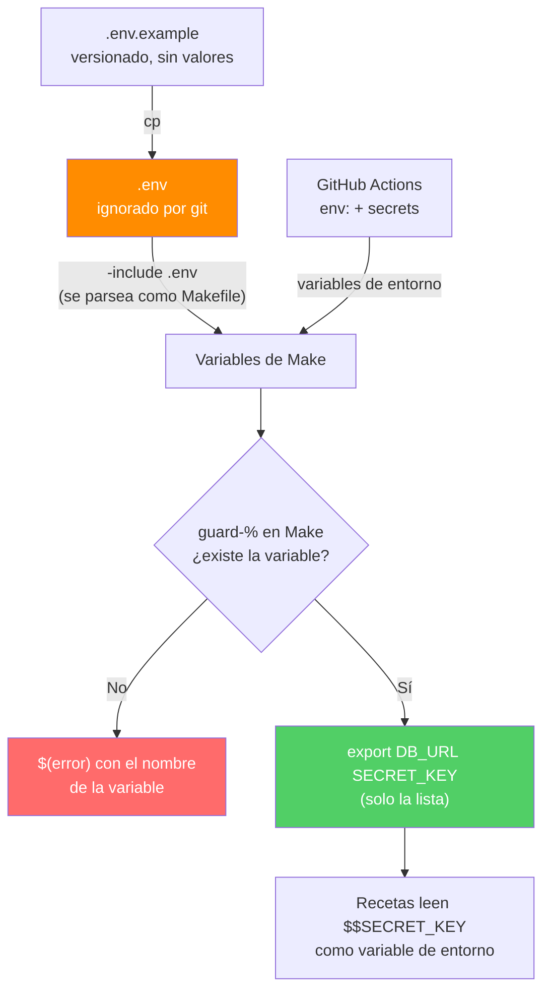

# Flujo de variables de entorno y secretos

En local los valores llegan de `.env`; en CI, del entorno que pone el runner, y `-include` hace que el mismo Makefile funcione en ambos casos. La validación ocurre dentro de Make (`$(if)` + `$(error)`), y las recetas leen el secreto como variable de entorno: nunca se pega en el texto de un comando.
