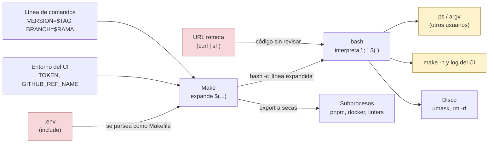

# Superficie de ataque de un Makefile

Todo lo que entra por la izquierda lo controla otra persona: quien crea el tag, la rama, el `.env` o el servidor de descargas. Atraviesa dos intérpretes (Make y bash) antes de ejecutarse, y cada salida de la derecha es un sitio donde un secreto puede quedar a la vista. Las defensas de la semana cortan una flecha cada una.
